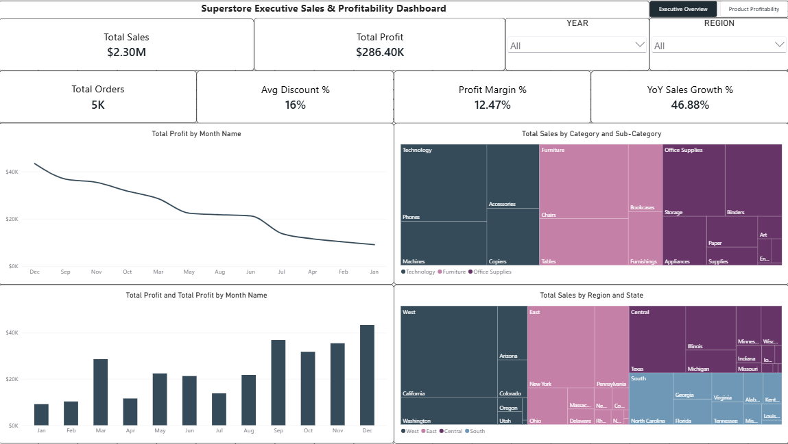
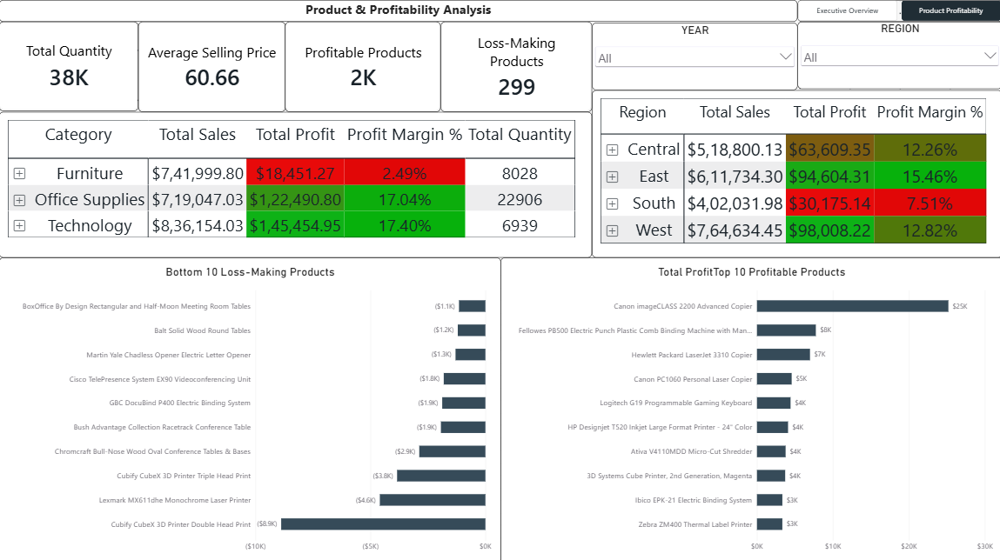
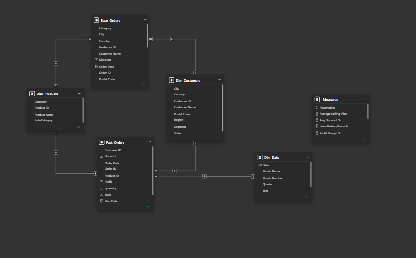

# Task 2 — Power BI Executive Sales & Profit Dashboard

## Project Overview

This project focuses on developing an interactive Power BI Executive Sales & Profit Dashboard using the Sample Superstore retail dataset. The objective was to transform cleaned retail transaction data into an interactive business intelligence report that enables stakeholders to monitor sales performance, profitability, product performance, and regional trends.

The dashboard was built using Power BI Desktop, Power Query, DAX, and a dimensional data model.

## Business Objectives

- Monitor overall sales, profit, order volume, and profitability.
- Analyse monthly sales and profit trends.
- Evaluate category and sub-category performance.
- Identify profitable and loss-making products.
- Compare regional sales and profitability.
- Provide interactive reporting through date and regional filters.

## Dataset

The Sample Superstore dataset contains retail transactions across different products, customers, categories, regions, and dates.

- **Source:** Sample Superstore retail sales dataset
- **Valid transaction rows:** 9,994
- **Data preparation:** Removed null and non-transaction rows from the raw dataset.
- **Key fields:** Order Date, Ship Date, Customer ID, Product ID, Category, Sub-Category, Sales, Quantity, Discount, Profit, Region and State.

## Data Cleaning & Preparation

Data preparation was performed using Power Query.

- Removed 806 null/non-transaction rows from the bottom of the raw CSV.
- Converted Order Date and Ship Date using the English (United States) locale.
- Set Sales, Profit and Discount to Decimal Number.
- Set Quantity to Whole Number.
- Set Postal Code to Text.
- Created a cleaned base query and referenced it to build the dimensional model.

## Data Model — Star Schema

The dashboard uses a star schema structure to improve data organisation and analytical flexibility.

### Fact Table

**Fact_Orders**

Contains transactional information:

- Order ID
- Order Date
- Ship Date
- Ship Mode
- Customer ID
- Product ID
- Sales
- Quantity
- Discount
- Profit

### Dimension Tables

**Dim_Customer**
- Customer ID
- Customer Name
- Segment
- Country
- City
- State
- Postal Code
- Region

**Dim_Product**
- Product ID
- Category
- Sub-Category
- Product Name

**Dim_Date**
- Date
- Year
- Quarter
- Month Number
- Month Name
- Year-Month

The Date dimension was created using DAX and marked as a Date Table.

Relationships were configured as one-to-many between the dimension tables and Fact_Orders.

## DAX Measures

The dashboard uses DAX measures to calculate key performance indicators and business metrics.

| Measure | Description |
|---|---|
| Total Sales | Total revenue generated from transactions |
| Total Profit | Total profit generated |
| Total Orders | Distinct count of order IDs |
| Profit Margin % | Profit divided by sales |
| Avg Discount % | Average transaction discount |
| YoY Sales Growth % | Sales growth compared with the previous year |
| Total Quantity | Total quantity of items sold |
| Average Selling Price | Sales divided by total quantity |
| Loss-Making Products | Count of products with negative aggregate profit |
| Profitable Products | Count of products with positive aggregate profit |

## Dashboard Pages

### Page 1 — Executive Sales Overview

Designed to provide a high-level overview of business performance.

Features:

- Total Sales KPI
- Total Profit KPI
- Total Orders KPI
- Profit Margin KPI
- Average Discount KPI
- YoY Sales Growth KPI
- Monthly Sales & Profit Trend
- Category & Sub-Category Sales Treemap
- Regional Sales Performance Treemap
- Interactive Date and Region slicers

### Page 2 — Product & Profitability Analysis

Designed to support deeper analysis of product-level and regional profitability.

Features:

- Total Quantity KPI
- Average Selling Price KPI
- Loss-Making Products KPI
- Profitable Products KPI
- Product Profitability Matrix
- Category, Sub-Category and Product hierarchy
- Top 10 Profitable Products
- Bottom 10 Products by Profit
- Regional Profitability Matrix
- Conditional formatting for profit and margin
- Interactive Date and Region filters

## Business Analysis Focus

The dashboard supports the following analytical use cases:

- Monitoring revenue and profit performance.
- Evaluating profitability across product categories and sub-categories.
- Identifying products with negative profitability.
- Comparing regional performance.
- Analysing monthly sales patterns.
- Exploring performance through interactive filtering and drill-down analysis.

## Tools & Technologies

- **Power BI Desktop** — Dashboard development and data modelling
- **Power Query** — Data cleaning and preparation
- **DAX** — Measures and KPI calculations
- **Excel / CSV** — Dataset source
- **GitHub** — Project documentation and version control

## Deliverables

- Power BI interactive dashboard (`.pbix`)
- Dashboard PDF export (`.pdf`)
- Dashboard screenshots
- Data model screenshot
- Project documentation

## Screenshots

### Executive Sales Overview

### Product & Profitability Analysis

### Data Model

## Project Outcome

This project demonstrates the application of data cleaning, dimensional modelling, DAX calculations, KPI development, interactive dashboard design and business-oriented data analysis using Power BI.

The dashboard transforms raw retail transaction data into a structured reporting solution that supports sales performance monitoring and profitability analysis.

## Data Source

The dashboard was developed using the Sample Superstore retail sales dataset. Data preparation and transformation were performed within Power Query to remove invalid rows, correct data types, and prepare the dataset for dimensional modelling.

The original dataset is available in `Task_1_Superstore_EDA/data/`. A cleaned dataset used for the Power BI dashboard is provided in `Task_2_PowerBI_Executive_Dashboard/data/` for reproducibility.

---

**Project:** Datheon Data Analytics & Power BI Internship  
**Task:** Task 2 — Power BI Executive Sales & Profit Dashboard  
**Author:** Arshad Muhammed